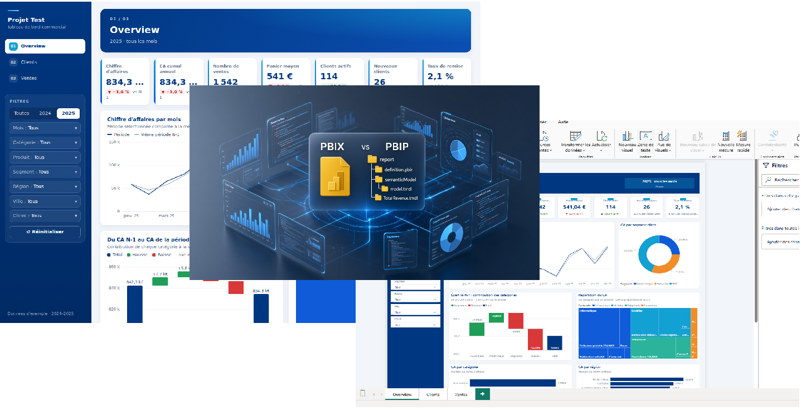
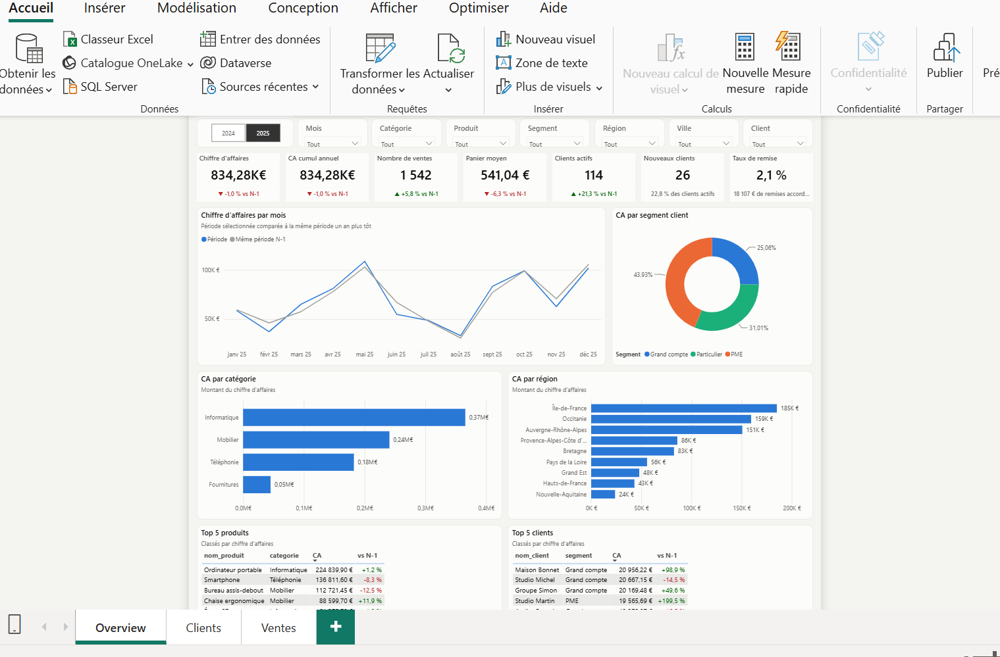
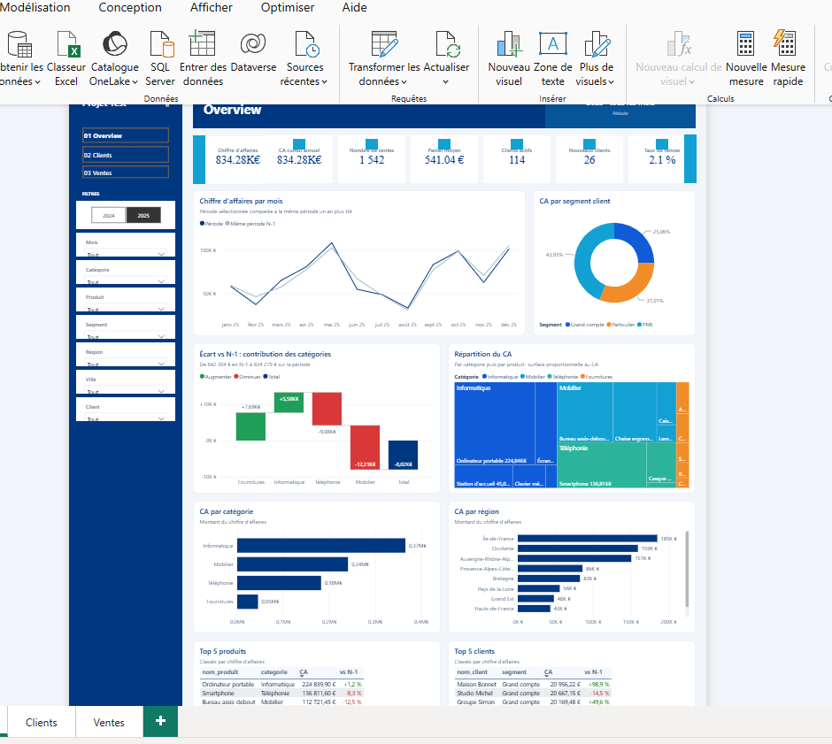
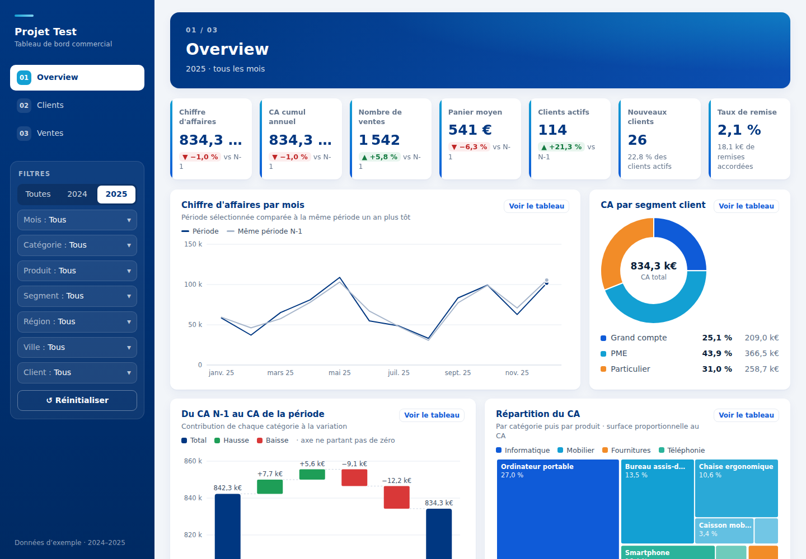
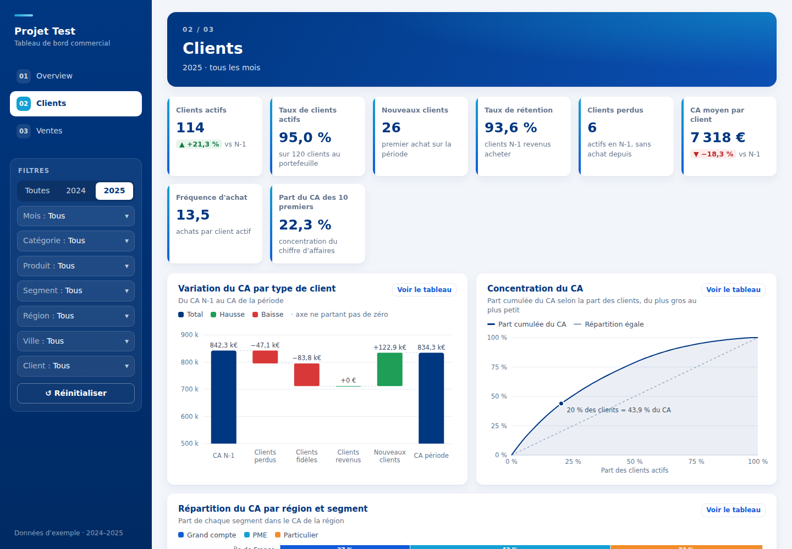
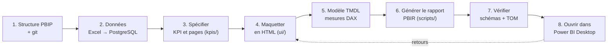

# Un tableau de bord Power BI construit comme du code



Ce dépôt montre une façon de construire un rapport Power BI **entièrement en fichiers texte** : données,
modèle, mesures DAX, pages et thème sont versionnés dans git, générés par des scripts et vérifiés
automatiquement, sans cliquer dans Power BI Desktop. Desktop ne sert plus qu'à **ouvrir et contrôler** le résultat.

Le projet d'exemple est un suivi commercial (ventes, clients, produits) en trois pages : Overview, Clients, Ventes.
Il existe en deux versions qui partagent le même modèle de données :

| v1 : thème clair, filtres en bandeau | v2 : thème bleu marine, barre latérale, cascades |
|---|---|
|  |  |

Avant Power BI, chaque version a d'abord été dessinée sous forme de **maquette HTML** interactive, sans dépendance :

| Maquette v2 : Overview | Maquette v2 : Clients |
|---|---|
|  |  |

---

## Pourquoi travailler ainsi ?

Un fichier `.pbix` est une boîte noire binaire : impossible de voir ce qui a changé, de relire une mesure
dans une revue de code ou de reconstruire le rapport à l'identique. Le format **PBIP** (Power BI Project)
découpe le rapport en fichiers texte lisibles :

- **TMDL** pour le modèle sémantique : tables, relations, mesures DAX, paramètres ;
- **PBIR** pour le rapport : une page = un dossier, un visuel = un fichier JSON.

À partir de là, on peut appliquer au tableau de bord les pratiques du développement logiciel :

- **historique git** : chaque mesure et chaque visuel a un historique, des différences lisibles, des commits ;
- **spécification avant réalisation** : les KPI et les pages sont décrits en Markdown, puis implémentés ;
- **maquette validée avant de construire** : le rendu visé est un fichier HTML qu'on ouvre dans n'importe quel navigateur ;
- **génération** : les pages du rapport sont produites par un script Python ; changer le thème ou la grille,
  c'est modifier quelques lignes et relancer le script ;
- **vérification automatique** : les fichiers sont validés contre les schémas JSON de Microsoft et le modèle
  est ouvert par la bibliothèque officielle, avant même de lancer Desktop.

### Et la sécurité ? Des données synthétiques jusqu'à la production

Tout le développement se fait sur des données synthétiques, générées par un script : par exemple des clients,
des produits et des ventes qui n'existent pas. Maquettes, mesures, visuels, tests : personne ne voit jamais une
vraie donnée. Pour passer en production, on garde le même rapport, on pointe la connexion vers la vraie base
(paramètres `ServeurPostgres` et `BasePostgres`) et on clique sur « Actualiser ». Les données de l'entreprise,
sensibles ou non, ne sortent jamais de leur environnement. Zéro fuite.

C'est encore plus pratique quand on développe avec une IA : l'assistant écrit le modèle, les mesures et les
visuels, les teste sur les fausses données… sans jamais avoir accès à la vraie base. On profite de l'IA sans
lui confier une seule donnée sensible.

---

## La démarche, étape par étape



### 1. Créer la structure PBIP et le dépôt git

Un projet PBIP, c'est un fichier d'entrée et deux dossiers :

```
ProjetTest.pbip                 ← le fichier qu'on ouvre dans Desktop (quelques octets : un simple pointeur)
ProjetTest.SemanticModel/       ← le modèle (TMDL)
ProjetTest.Report/              ← le rapport (PBIR), relié au modèle par definition.pbir
```

Le `.gitignore` exclut le cache local de Desktop (`.pbi/cache.abf`, `.pbi/localSettings.json`) et les secrets (`.env`).

### 2. Préparer les données : des fichiers Excel, puis PostgreSQL

On démarre souvent avec des fichiers Excel ; la cible est une vraie base. Ici, un seul script génère
un jeu de données d'exemple réaliste (saisonnalité, arrivées et départs de clients, remises) dans trois formats
identiques : Excel (`sources/*.xlsx`), SQL pour PostgreSQL et JavaScript pour les maquettes.

```bash
python3 -m venv .venv && .venv/bin/pip install -r scripts/requirements.txt
.venv/bin/python scripts/generer_donnees.py      # graine fixe : fichiers reproductibles à l'octet près
```

La base PostgreSQL tourne dans Docker et se charge toute seule au premier démarrage :

```bash
cd sources
cp .env.example .env          # choisir un mot de passe ; .env n'est jamais commité
docker compose up -d
```

### 3. Spécifier les KPI et les pages (`kpis/`)

Avant d'écrire une ligne de DAX, on décrit **ce que le rapport doit montrer** :

- [`kpis/kpis.md`](kpis/kpis.md) : 42 KPI, chacun avec sa définition métier, sa formule DAX, son format et son statut
  (chiffre d'affaires, évolutions N-1, cumul annuel, remises, fidélité des clients, effets volume / prix / mix…) ;
- [`kpis/pages.md`](kpis/pages.md) : pour chaque page, son objectif, son public, ses tuiles et ses visuels, et la charte graphique.

Ce document sert de contrat : la maquette, le modèle et le rapport doivent tous le respecter.

### 4. Maquetter le rendu en HTML (`ui/`)

La maquette est un vrai tableau de bord interactif, en HTML et JavaScript sans dépendance : filtres, infobulles,
vue tableau de chaque graphique, et KPI **calculés comme les futures mesures DAX** sur les mêmes données.
On l'ouvre en double-cliquant sur `ui/index.html`.

Elle permet de valider le contenu et le design avec les utilisateurs **avant** de construire dans Power BI,
et sert ensuite de référence visuelle. La v2 a ajouté des visuels qui expliquent le chiffre d'affaires :
cascade des écarts par catégorie, cascade par type de client (perdus, fidèles, revenus, nouveaux),
décomposition volume / prix / mix, treemap, courbe de concentration, barres empilées à 100 %.

### 5. Écrire le modèle en TMDL

Le modèle ([`ProjetTest.SemanticModel/definition/`](ProjetTest.SemanticModel/definition)) se lit comme du code :

```
expressions.tmdl            ← paramètres ServeurPostgres, BasePostgres
relationships.tmdl          ← Ventes → Clients, Produits, Calendrier
tables/Ventes.tmdl          ← requête Power Query vers PostgreSQL + 82 mesures DAX rangées en dossiers
tables/Calendrier.tmdl      ← table de dates calculée en DAX
tables/Pont prix.tmdl       ← étapes des graphiques en cascade
```

Exemple de mesure, telle qu'elle apparaît dans le fichier :

```
	/// E01 · Écart dû aux quantités, valorisé au prix moyen N-1.
	measure 'Effet volume' = IF(NOT ISBLANK([CA N-1]), ([Quantité vendue] - [Quantité vendue N-1]) * [Prix moyen N-1])
		formatString: +#,0 €;-#,0 €;0 €
		displayFolder: Explication du CA
```

### 6. Générer le rapport PBIR (`scripts/`)

Les pages ne sont pas dessinées à la main : un script Python écrit chaque visuel (position, champs, mise en forme)
à partir d'une grille et d'une charte.

```bash
python3 scripts/generer_rapport.py       # rapport v1 → ProjetTest.Report/
python3 scripts/generer_rapport_v2.py    # rapport v2 → ProjetTestV2.Report/ + ProjetTestV2.pbip
```

Une seule fonction ajoute par exemple un graphique en cascade :

```python
cascade(p, "pont-prix", 0, y, 6, 340, "Variation du CA : volume, prix, mix",
        etape, mes("Montant pont prix"), tri(etape, "Ascending"))
```

Conséquence : les pages générées ne se modifient **pas** dans Desktop (elles seraient écrasées à la génération suivante).
On modifie le script et on relance, Desktop fermé. Le modèle, lui, n'est pas généré : les mesures ajoutées dans Desktop sont conservées.

### 7. Vérifier sans Power BI

Deux contrôles automatiques, utilisables sous Linux ou en intégration continue (dossier [`outils/`](outils)),
à lancer depuis la racine du dépôt :

```bash
# Rapport : chaque fichier JSON est validé contre le schéma Microsoft qu'il déclare
(cd outils/valider-pbir && npm install && node valider.mjs ../../ProjetTest.Report ../../ProjetTestV2.Report)
# → 268 fichiers, 0 en erreur

# Modèle : ouverture par la bibliothèque officielle Microsoft (TOM), dans Docker
docker run --rm -v "$PWD":/projet:ro mcr.microsoft.com/dotnet/sdk:8.0 sh -c \
  "cp -r /projet/outils/valider-tmdl /tmp/v && cd /tmp/v && dotnet run -v q -- /projet/ProjetTest.SemanticModel/definition"
# → Base OK : niveau 1600, culture fr-FR, puis la liste des tables, relations et tris
```

### 8. Ouvrir dans Power BI Desktop

Power BI Desktop tourne sous Windows ; ici, la base est sur un serveur Linux. Un tunnel SSH la rend visible en `localhost` :

1. Ouvrir le tunnel depuis le poste Windows (laisser la fenêtre ouverte) :
   ```bash
   ssh -N -L 5433:localhost:5433 <utilisateur>@<serveur>
   ```
2. Récupérer le projet **en un seul bloc** : `git clone`, ou l'archive `dist/ProjetTest.zip`
   (créée par `python3 scripts/empaqueter.py`, copiée avec `scp`).
3. Ouvrir `ProjetTest.pbip` ou `ProjetTestV2.pbip`, puis **Actualiser**.
4. Identifiants : onglet **Base de données**, utilisateur `powerbi`, mot de passe de `sources/.env`.
   Le tunnel chiffre déjà le trafic : accepter la connexion non chiffrée quand Desktop la propose.

N'ouvrir qu'un rapport à la fois : les deux partagent le modèle et son cache.
Le format PBIR demande une version récente de Desktop (sur une version antérieure à 2026, activer
« Stocker les rapports au format de métadonnées amélioré (PBIR) » et « Format TMDL du modèle sémantique »
dans **Fichier > Options > Fonctionnalités en préversion**).

---

## Pièges rencontrés (et leur solution)

| Symptôme | Cause | Solution |
|---|---|---|
| Desktop : *Required artifact is missing … definition.pbir* | Fichiers copiés un par un vers Windows : certains arrivent vides | Copier le projet en un seul bloc (`git clone` ou archive zip) |
| Le `.pbip` ne « pèse » qu'1 Ko | C'est normal : il ne contient qu'un pointeur vers les dossiers | Toujours garder le `.pbip` à côté de ses dossiers `.Report` et `.SemanticModel` |
| Le thème ne se charge pas | Thème de base `CY24SU10.json` tronqué | Reprendre le fichier complet produit par Desktop |
| Erreur TMDL sur un nom de mesure | Noms entre guillemets doubles | En TMDL, les noms avec espaces s'écrivent entre apostrophes : `'Chiffre d''affaires'` |
| Filtre « N premiers » refusé par le schéma | Format `VisualTopN` incomplet | Écrire le filtre comme Desktop : une sous-requête triée et limitée (`Subquery`) |
| Fichiers Excel « modifiés » à chaque génération | Date de création stockée dans le zip `.xlsx` | Fixer les horodatages pour une sortie identique à l'octet près |
| Écarts invisibles dans une cascade | Axe partant de 0 alors que les écarts font 1 % des totaux | Axe resserré (comme un pont financier), signalé dans la légende |

Règles de visualisation appliquées partout : jamais deux axes sur un même graphique, une couleur fixe par entité
(une catégorie garde sa couleur quel que soit le filtre), palettes vérifiées pour les daltoniens,
hausse ▲ et baisse ▼ toujours signalées par une flèche en plus de la couleur.

---

## Démarrage rapide

```bash
git clone <ce dépôt> && cd projet-test
python3 -m venv .venv && .venv/bin/pip install -r scripts/requirements.txt
.venv/bin/python scripts/generer_donnees.py                    # données d'exemple (Excel, SQL, maquettes)
(cd sources && cp .env.example .env && docker compose up -d)   # base PostgreSQL sur le port 5433
xdg-open ui/index.html                                         # maquettes (ou double-clic sous Windows)
python3 scripts/generer_rapport_v2.py                          # régénérer le rapport v2
```

Puis ouvrir `ProjetTestV2.pbip` dans Power BI Desktop (étape 8).

## Structure du dépôt

| Chemin | Contenu |
|---|---|
| `ProjetTest.pbip`, `ProjetTestV2.pbip` | Points d'entrée Power BI Desktop (rapport v1, rapport v2) |
| `ProjetTest.SemanticModel/` | Modèle de données (TMDL), commun aux deux rapports |
| `ProjetTest.Report/`, `ProjetTestV2.Report/` | Rapports (PBIR), générés |
| `sources/` | Excel d'exemple, `docker-compose.yml` PostgreSQL, `.env.example` |
| `sources/postgres/init/` | Schéma et données SQL chargés au premier démarrage |
| `scripts/generer_donnees.py` | Jeu de données d'exemple (Excel, SQL, JavaScript) |
| `scripts/generer_rapport.py`, `scripts/generer_rapport_v2.py` | Génération des rapports PBIR v1 et v2 |
| `scripts/empaqueter.py` | Archive `dist/ProjetTest.zip` à copier sur le poste Windows |
| `kpis/` | Spécification : catalogue des KPI, pages, chartes |
| `ui/` | Maquettes HTML v1 (`ui/*.html`) et v2 (`ui/v2/`), captures (`ui/images/`) |
| `outils/` | Validation des fichiers PBIR (Node.js) et du modèle TMDL (.NET, dans Docker) |

### Maquettes (`ui/`)

| Fichier | Rôle |
|---|---|
| `ui/assets/app.js` | Données, filtres (conservés d'une page à l'autre), calcul des KPI, structure des pages |
| `ui/assets/charts.js` | Graphiques SVG : courbes, barres, anneau, nuage, cascade, treemap, barres à 100 %, concentration, tableaux, matrice |
| `ui/assets/pages/*.js` | Contenu de chaque page (KPI et visuels), commun à la v1 et à la v2 |
| `ui/assets/style.css` | Thème v1 (clair / sombre) |
| `ui/v2/v2.css`, `ui/v2/v2.js` | Habillage et disposition de la v2 |
| `ui/assets/donnees.js` | Données générées — ne pas modifier à la main |

### Base PostgreSQL

```bash
docker exec -it projet-test-postgres psql -U powerbi -d ventes        # console SQL
docker compose down -v && docker compose up -d                        # recharger les données (depuis sources/)
```

Les scripts de `sources/postgres/init/` ne s'exécutent qu'à la création du volume.
Par défaut, la base n'écoute que sur `127.0.0.1` (variable `POSTGRES_BIND`) : on y accède par le tunnel SSH.

---

## Adapter à vos propres données

1. Remplacer les tables de `sources/postgres/init/01_schema.sql` et les requêtes des tables du modèle
   (`ProjetTest.SemanticModel/definition/tables/*.tmdl`) par vos tables.
2. Réécrire le catalogue `kpis/kpis.md`, puis les mesures DAX correspondantes.
3. Adapter les pages des maquettes (`ui/assets/pages/*.js`) et les faire valider.
4. Adapter les fonctions de page des générateurs (`page_overview`, `page_clients`, `page_ventes`) et la charte
   (couleurs en tête de `scripts/generer_rapport_v2.py`), puis régénérer et vérifier.
